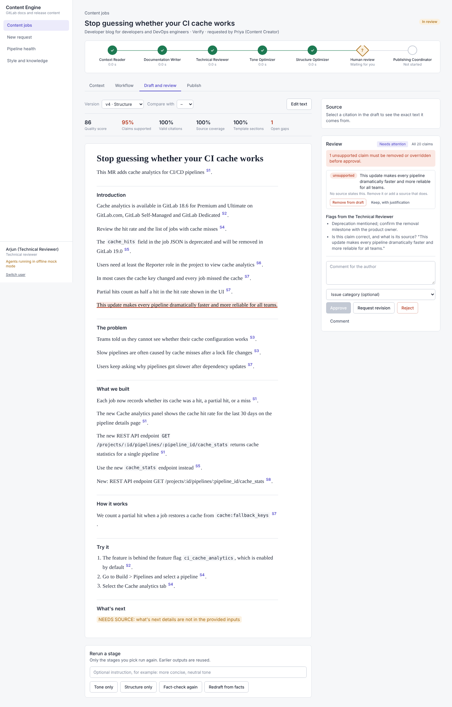
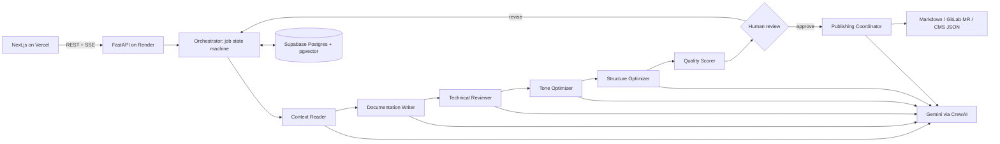

# GitLab AI Content & Documentation Engine

Turn GitLab code changes, merge requests and API specs into **source-grounded, human-approved** release notes, documentation pages, developer blogs, API references and onboarding guides.

| | |
|---|---|
| **Live app** | [gitlab-ai-content-documentation-eng.vercel.app](https://gitlab-ai-content-documentation-eng.vercel.app) |
| **API** | [content-engine-api-76k0.onrender.com](https://content-engine-api-76k0.onrender.com) · interactive docs at [/docs](https://content-engine-api-76k0.onrender.com/docs) |
| **Demo video** | `https://drive.google.com/...` ← "Anyone with the link can view" |
| **Capstone brief** | [AlmaBetter: GitLab AI Content & Documentation Engine](https://almabetter.notion.site/GitLab-AI-Content-Documentation-Engine-38a1a19a561781efb1b3e7f00da7c01c) |

> **Note:** the backend runs on Render's free plan, which sleeps when idle. The first request after a quiet period takes about a minute while it wakes up; after that the app responds normally. If the live app looks stuck on first load, open the [API docs](https://content-engine-api-76k0.onrender.com/docs) once to wake it, then reload.



## The problem

GitLab ships merge requests, API changes and deprecations faster than writers, reviewers and subject-matter experts can document them. Late or inaccurate documentation creates support load, confuses customers and field teams, and weakens release communication.

This engine does not replace writers or reviewers. It gives them a better starting point: it organises the technical context, drafts content in GitLab's structure and voice, checks every claim against its sources, and routes the result through an approval gate before anything is published.

**Design principle: content generation as a governed workflow, not a text generator.**

- Every request is a **job** with a visible state, timestamps, errors and version history.
- Every sentence cites its **source** (`[S3]` → the exact chunk of the diff, spec or doc it came from).
- **Unsupported claims block approval** until a reviewer removes them or overrides them with a written reason.
- **Nothing is exported** unless the latest version has a recorded human approval.
- Every model call, prompt version, review action and export is **audited**.

## Features by product surface

| Surface | What it does | Screenshot |
|---|---|---|
| Content intake | Four-step request: content type, audience and channel, sources (upload or paste), reviewer and deadline. Secrets are redacted on upload. | [intake](docs/screenshots/intake.png) |
| Context builder | Facts with source ids and confidence, retrieved docs with match score and freshness, gaps, conflicts, prompt-injection flags. Exclude sources and rebuild. | [context](docs/screenshots/context-review.png) |
| Agent workflow console | Live pipeline graph of the six agents (server-sent events), each stage's JSON output, prompt version, model, latency, tokens, errors and Retry. | [workflow](docs/screenshots/workflow-live.png) |
| Draft editor | Draft rendered as a document, clickable citations with a source panel, quality badges, inline edit, version diff, rerun of single stages with instructions. | [draft](docs/screenshots/draft-review.png) |
| Review panel | Claim-by-claim verdicts, remove or override with justification, approve / request revision / reject, comments with issue categories. | same |
| Publishing | Publishing Coordinator prepares file path, front matter, MR title, labels and description; export as Markdown, CMS JSON or a real GitLab merge request. Audit trail. | [publish](docs/screenshots/publish.png) |
| Pipeline health | Backlog, time to draft, approval cycle time, rework rate, quality, writer prompt v1 vs v2, latency per agent, weekly throughput, exports. | [dashboard](docs/screenshots/dashboard.png) |
| Style and knowledge | Templates per content type, tone rules per channel, glossary, knowledge base with a retrieval playground, all prompt versions. | – |

## Architecture



Full details: [docs/architecture.md](docs/architecture.md) · state machine: [docs/workflow_states.md](docs/workflow_states.md).

| Layer | Technology |
|---|---|
| Frontend | Next.js 16 (App Router), React 19, Tailwind CSS 4, Recharts |
| Backend | FastAPI, SQLAlchemy 2, Pydantic 2, structlog |
| Agents | CrewAI (one single-task crew per stage) |
| LLM / embeddings | Gemini through CrewAI/LiteLLM; Gemini embeddings (768-d) |
| Data | Supabase Postgres + pgvector (SQLite locally) |
| Publishing | GitLab REST API (branch, commit, merge request), Markdown, CMS JSON |
| Quality | pytest (39 tests), evaluation harness, Vale + markdownlint style rules, GitHub Actions / GitLab CI |

## Multi-agent workflow

| # | Agent | Input | Output (schema) | Notes |
|---|---|---|---|---|
| 1 | Context Reader | Job inputs + retrieved KB chunks | `ContextPack`: facts with source ids, gaps, blocking gaps, conflicts, terminology | Blocking gaps stop the job in `NEEDS_INPUT`. Parses diffs and OpenAPI specs into facts. Ignores instruction-like text. |
| 2 | Documentation Writer | ContextPack + template + tone + glossary | `Draft` with `[S#]` citations | Writes `[NEEDS SOURCE: …]` rather than inventing. Prompts v1–v3 kept for comparison (v3: one source per bracket, `[S1] [S2]`). |
| 3 | Technical Reviewer | Draft + sources | `TechReviewOutput`: verdict per claim, risk flags, reviewer questions, corrected citations | Never silently deletes; unsupported claims block approval. |
| 4 | Tone Optimizer | Draft + channel tone rules + glossary | `Draft` + change log | Protects code, citations and markers; fixes terminology ("pull request" → "merge request"). |
| 5 | Structure Optimizer | Draft + content-type template | `Draft` + change log | Enforces required headings and order, numbered steps, summary length. |
| – | Quality Scorer | Draft + claims | `QualityScores` | Deterministic: coverage, citation validity, claim support, structure, readability. |
| 6 | Publishing Coordinator | Approved draft | `PublishPackage`: slug, file path, front matter, MR title/description, labels | Runs only after approval. |

Each stage is persisted before the next starts, so any stage can be **rerun on its own** (`POST /api/drafts/{id}/refine {"stages": ["tone"]}`) and failures **resume** at the failed stage.

## Prompt engineering

- One YAML file per agent per version in `ai/prompts/<agent>/v<N>.yaml` with role, goal, backstory, system and user templates.
- Content-type structure in `ai/prompts/content_types/`, tone per channel in `ai/prompts/tone/`.
- Every prompt: role → inputs wrapped in delimiters and labelled as data → rules → output schema → self-check.
- Outputs are validated against Pydantic schemas (`ai/schemas/content.py`) via CrewAI `output_pydantic`.
- Prompt versions are synced to the `prompt_versions` table with a file hash; every `agent_runs` row records the version used. Pin a version per run (`prompt_versions: {"draft": 1}`) or per environment (`PROMPT_VERSION_DOCUMENTATION_WRITER=1`).

## Data, retrieval and knowledge

- `data/sample_docs/`: 10 GitLab-style docs pages (written for this project in GitLab's documentation style, one deliberately stale).
- `data/style_guides/`: voice and tone guide, glossary of 30 GitLab terms.
- `data/content_templates/`: one skeleton per content type.
- `data/sample_inputs/`: a coherent demo feature (MR description, diff, OpenAPI spec, release summary, issue thread) plus edge cases (incomplete, conflicting, prompt injection, secrets).
- Chunking by heading (≤ 450 words, 60-word overlap, code blocks never split), stable ids `<doc>#<anchor>#<n>` used as citation targets.
- Retrieval: pgvector cosine search in Postgres (HNSW index), in-process cosine on SQLite; product-area boost; freshness flag for docs older than 12 months.

## Evaluation

`python -m ai.evaluation.run_eval` runs the four demo scenarios twice (one-shot writer v1 vs full multi-agent workflow), grades key-fact recall against `data/eval/golden/` and writes [docs/evaluation_report.md](docs/evaluation_report.md). Re-run with `LLM_PROVIDER=crewai` for real-model numbers before submission.

## Security and governance

Role-based access (creator, technical reviewer, documentation lead, publisher, admin) on every endpoint · Supabase JWT verification · backend-only secrets · secret redaction on upload (GitLab/GitHub/AWS/Google keys, private keys, JWTs, passwords, emails) · prompt-injection screening · server-side approval gate · approval voided by later edits · append-only audit log (Postgres trigger) · row-level security · CORS allowlist · upload size and type limits · production refuses dev auth.

## API

Summary below; full reference with examples in [docs/api_documentation.md](docs/api_documentation.md) and live at `/docs`.

`POST /api/content-jobs` · `POST /api/content-jobs/{id}/inputs` · `POST /api/context-pack` · `POST /api/agent-workflow/run` · `GET /api/content-jobs/{id}` · `GET /api/content-jobs/{id}/events` · `POST /api/drafts/{id}/review` · `POST /api/drafts/{id}/refine` · `GET /api/drafts/{id}/versions` · `POST /api/publish/prepare` · `POST /api/publish/export` · `GET /api/metrics` · `POST /api/kb/ingest` · `GET /api/audit-logs`

## Run it locally

Step-by-step team guide (VS Code + Claude, keys, Supabase, GitLab, deployment): see the shared build guide, and `CLAUDE.md` for project rules.

Prerequisites: Python 3.11+, Node 20+.

```bash
# Backend (mock agents, SQLite, demo users: no keys needed)
python -m venv .venv && source .venv/bin/activate
pip install -r requirements-dev.txt
cp .env.example .env
uvicorn backend.main:app --reload            # http://localhost:8000/docs

# Frontend
cd frontend
cp .env.local.example .env.local
npm install
npm run dev                                   # http://localhost:3000

# Demo data (in another terminal, backend running)
python scripts/seed_demo.py

# Tests and evaluation
pytest -q
python -m ai.evaluation.run_eval
```

Real models: `pip install -r requirements-ai.txt`, then set `LLM_PROVIDER=crewai` and `GEMINI_API_KEY` in `.env`.

Demo users (dev auth only): Priya (creator), Arjun (technical reviewer), Meera (documentation lead), Rahul (publisher).

## Deployment

- Environment and services: [deployment/environment_setup.md](deployment/environment_setup.md)
- Backend on Render or Railway: [deployment/backend_deployment.md](deployment/backend_deployment.md)
- Frontend on Vercel: [deployment/vercel_notes.md](deployment/vercel_notes.md)

## Repository layout

```
├── frontend/          Next.js app: app/ (routes), components/, content-editor/, review-panel/, styles/
├── backend/           api/, auth/, services/, orchestration/, database/ (models + SQL migrations), publishing/
├── ai/                agents/ (six agents), prompts/ (versioned YAML), schemas/, retrieval/, evaluation/
├── data/              sample_inputs/, sample_docs/, style_guides/, content_templates/, eval/golden/
├── docs/              architecture, API, workflow states, demo script, evaluation report, screenshots
├── tests/             functional_tests/, ai_output_tests/, security_tests/, edge_cases/
├── deployment/        environment, backend and Vercel notes
└── scripts/           seed_demo.py
```

## Team contributions

| Member | Role | Owned | Key merge requests |
|---|---|---|---|
| M1 – _name_ | Team lead, product and integration | README, docs/, demo, sample inputs | _links_ |
| M2 – _name_ | Frontend A | Intake, context review, workflow monitor, login, library | |
| M3 – _name_ | Frontend B | Draft editor, review panel, publish panel, dashboard | |
| M4 – _name_ | Backend | API, auth, state machine, database, audit | |
| M5 – _name_ | AI engineer A | Agents, orchestrator, quality scorer | |
| M6 – _name_ | AI engineer B | Prompts, schemas, retrieval, knowledge base | |
| M7 – _name_ | QA, security, DevOps | Tests, eval harness, redaction, CI, deployment, GitLab export | |

## Limitations and next steps

- Mock mode agents are deterministic stand-ins for development and CI; content quality claims should be judged on `LLM_PROVIDER=crewai` runs.
- Background work uses FastAPI background tasks; a queue (RQ/Celery) would be next for many concurrent jobs.
- Inline comments are per version, not anchored to text ranges.
- Planned: LLM-as-judge tone scoring in the eval (`ai/prompts/evaluation/tone_judge_v1.yaml`), Slack notifications for reviewers, GitLab webhook to start jobs when an MR is labelled `docs-needed`.

## References

[CrewAI](https://docs.crewai.com/) · [LangChain](https://python.langchain.com/docs/) · [Gemini API](https://ai.google.dev/gemini-api/docs) · [Supabase](https://supabase.com/docs) · [pgvector](https://github.com/pgvector/pgvector) · [FastAPI](https://fastapi.tiangolo.com/) · [Next.js](https://nextjs.org/docs) · [GitLab REST API](https://docs.gitlab.com/api/) · [GitLab CI/CD](https://docs.gitlab.com/ci/) · [Vale](https://vale.sh/) · Brief reference repos: [documentation-writer-flow](https://github.com/clusterknot/ai-engineering-hub/tree/main/documentation-writer-flow), [context-engineering-workflow](https://github.com/clusterknot/ai-engineering-hub/tree/main/context-engineering-workflow)
