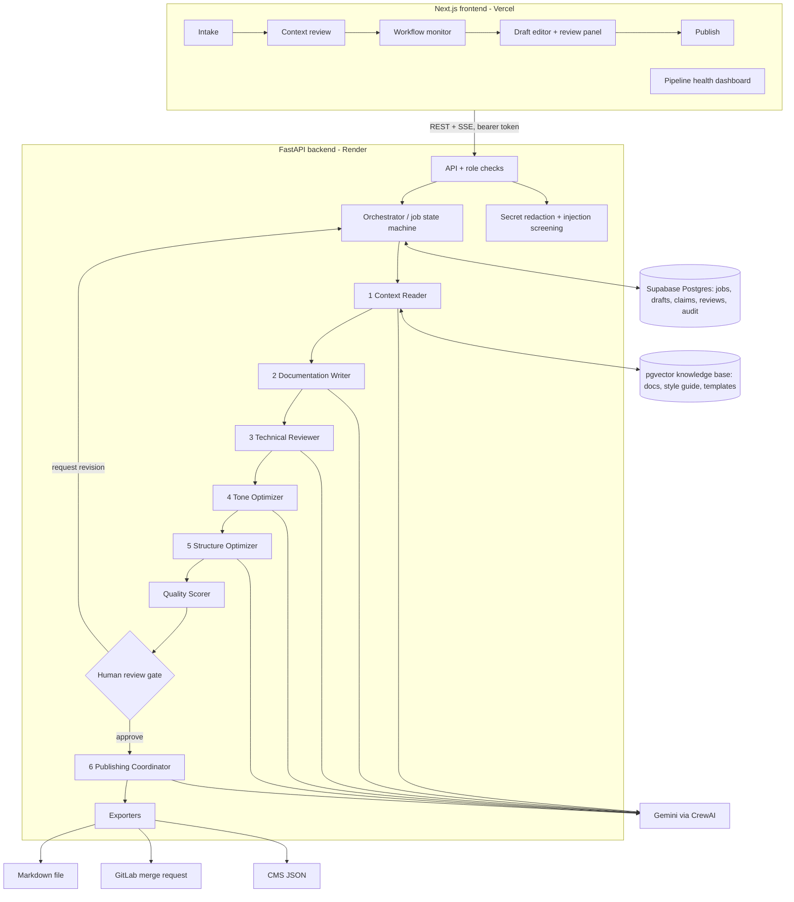

# Architecture

The engine is organised around one idea: **every content request is a job that moves through visible stages, and nothing leaves the system without a human approval.**

## Layers

| Layer | Folder | Responsibility |
|---|---|---|
| Product | `frontend/` | Intake stepper, context review, live workflow monitor, draft editor with source panel, review panel, publish panel, dashboard, library |
| API | `backend/api/` | Content jobs, inputs, context pack, workflow runs, drafts, reviews, refinement, publishing, metrics, knowledge base, audit |
| Auth | `backend/auth/` | Dev demo users or Supabase JWT verification; `require_role` guard on every route |
| Orchestration | `backend/orchestration/` | Job state machine (`states.py`) and the stage runner (`runner.py`) |
| Agents | `ai/agents/<agent>/agent.py` | One file per agent: variables for its prompt, its output schema, and a deterministic mock |
| Prompts | `ai/prompts/` | Versioned YAML prompts, content-type templates, tone rules per channel |
| Schemas | `ai/schemas/` | Pydantic models every agent must return (`ContextPack`, `Draft`, `TechReviewOutput`, `PublishPackage`, `QualityScores`) |
| Retrieval | `ai/retrieval/` | Chunking, embeddings, ingestion, similarity search, context-pack assembly, glossary |
| Evaluation | `ai/evaluation/` | Deterministic quality scorer and the one-shot vs multi-agent eval harness |
| Publishing | `backend/publishing/` | Markdown, CMS JSON and GitLab merge request adapters |
| Data | `data/` | Knowledge base docs, style guide, glossary, templates, demo inputs, golden eval files |

## Why one crew per stage

CrewAI could run all agents in one sequential crew. We run each agent as its own single-task crew instead, and the orchestrator saves each stage's validated JSON before starting the next. That gives us:

- **Visible intermediate outputs**: every `agent_runs` row holds the stage's JSON, prompt version, model, latency and tokens.
- **Single-stage reruns**: `POST /api/drafts/{id}/refine {"stages": ["tone"]}` reuses saved outputs and runs only tone.
- **Recovery**: when a stage fails, earlier outputs are kept and Retry resumes at the failed stage.

## Grounding and governance

1. Every source (job metadata, each input chunk, each retrieved KB chunk) gets a citation id `S0, S1, …` that maps to a stable chunk id.
2. The writer must cite `[S#]` and write `[NEEDS SOURCE: …]` instead of inventing facts.
3. The Technical Reviewer checks each sentence. Unsupported claims are **not** silently deleted: they are stored in `claim_checks`, highlighted in the editor, and block approval until a reviewer removes them or overrides them with a written justification.
4. The deterministic Quality Scorer re-validates citations whatever the model said.
5. `POST /api/publish/export` refuses anything that is not the latest version with a recorded approval. Editing an approved draft creates a new version and voids the approval.
6. Inputs are scanned for secrets (redacted before storage or any model call) and for instruction-like text (ignored as facts and flagged).
7. Every status change, review action, model call and export is written to `audit_logs`.

## Mock mode

`LLM_PROVIDER=mock` swaps each LLM call for a deterministic implementation of the same agent. The API, state machine, database, UI and governance checks behave exactly as in production. Use it for development, CI and as a fallback during the demo if the model quota runs out. Set `LLM_PROVIDER=crewai` with a `GEMINI_API_KEY` for real generation.
