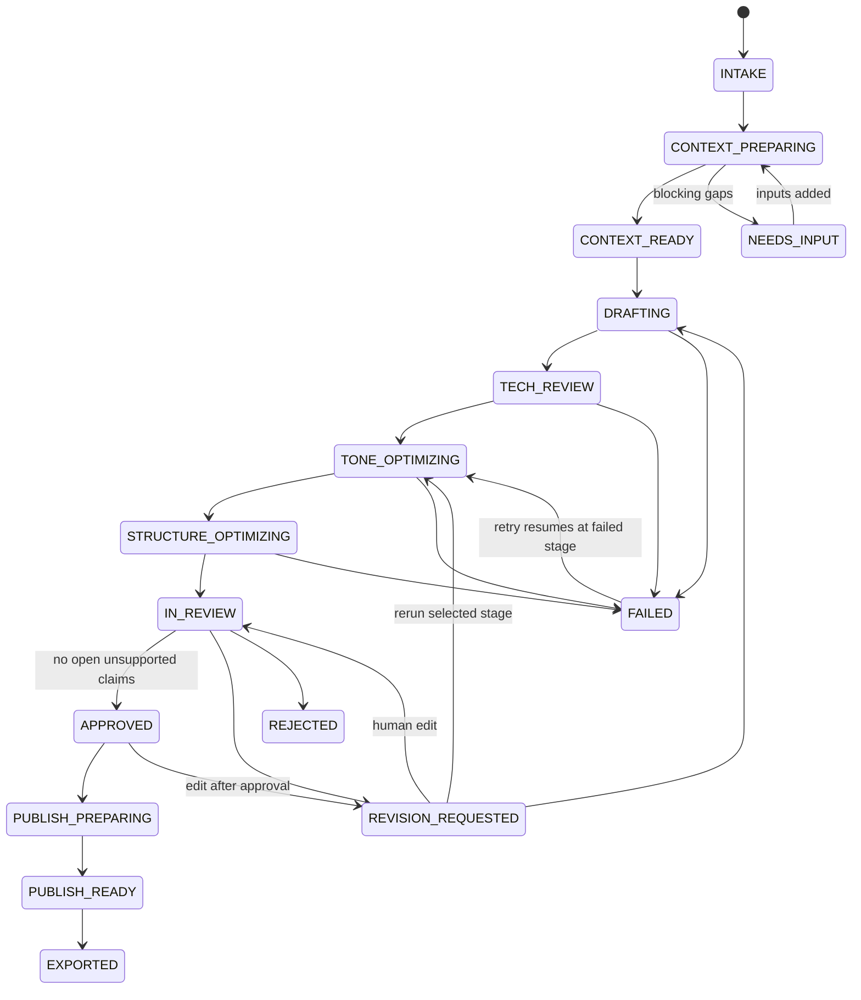

# Workflow states

`content_jobs.status` is the single source of truth for where a job is. Transitions are enforced in `backend/orchestration/states.py`; an illegal move returns `409 INVALID_STATE`.

| Status | Meaning | Who acts next |
|---|---|---|
| `INTAKE` | Job created, inputs attached | Creator starts the workflow |
| `CONTEXT_PREPARING` | Retrieval + Context Reader running | System |
| `CONTEXT_READY` | Context pack built, no blocking gaps | System continues, or creator reviews context |
| `NEEDS_INPUT` | Context Reader found blocking gaps | Creator adds inputs |
| `DRAFTING` / `TECH_REVIEW` / `TONE_OPTIMIZING` / `STRUCTURE_OPTIMIZING` | Agent stage running | System |
| `IN_REVIEW` | Draft scored and waiting for a human | Technical reviewer or documentation lead |
| `REVISION_REQUESTED` | Reviewer asked for changes, or a rerun is queued | System or creator |
| `REJECTED` | Reviewer rejected the draft | Creator revises |
| `APPROVED` | Latest version approved | Publisher |
| `PUBLISH_PREPARING` / `PUBLISH_READY` | Publishing Coordinator prepared metadata | Publisher exports |
| `EXPORTED` | Published as Markdown, CMS JSON or merge request | – |
| `FAILED` | A stage failed after retries; `last_error` explains | Creator retries |

## Stage outputs

| Stage | Agent | Output schema | New draft version? |
|---|---|---|---|
| `context` | Context Reader | `ContextPack` | No (stored in `context_packs`) |
| `draft` | Documentation Writer | `Draft` | Yes |
| `tech_review` | Technical Reviewer | `TechReviewOutput` (report + draft) | Yes, plus `claim_checks` rows |
| `tone` | Tone Optimizer | `Draft` | Yes |
| `structure` | Structure Optimizer | `Draft` | Yes |
| `quality` | Quality Scorer (no LLM) | `QualityScores` | No (scores on latest draft) |
| `publish_prep` | Publishing Coordinator | `PublishPackage` | No |
